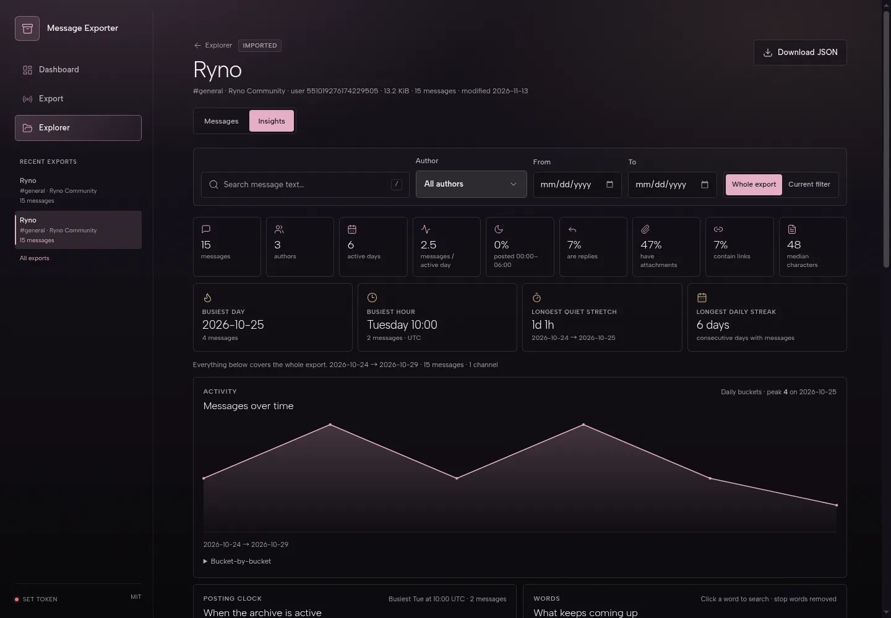
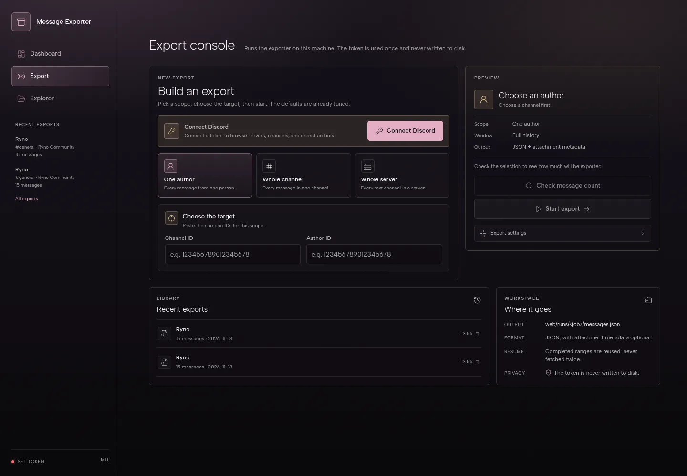
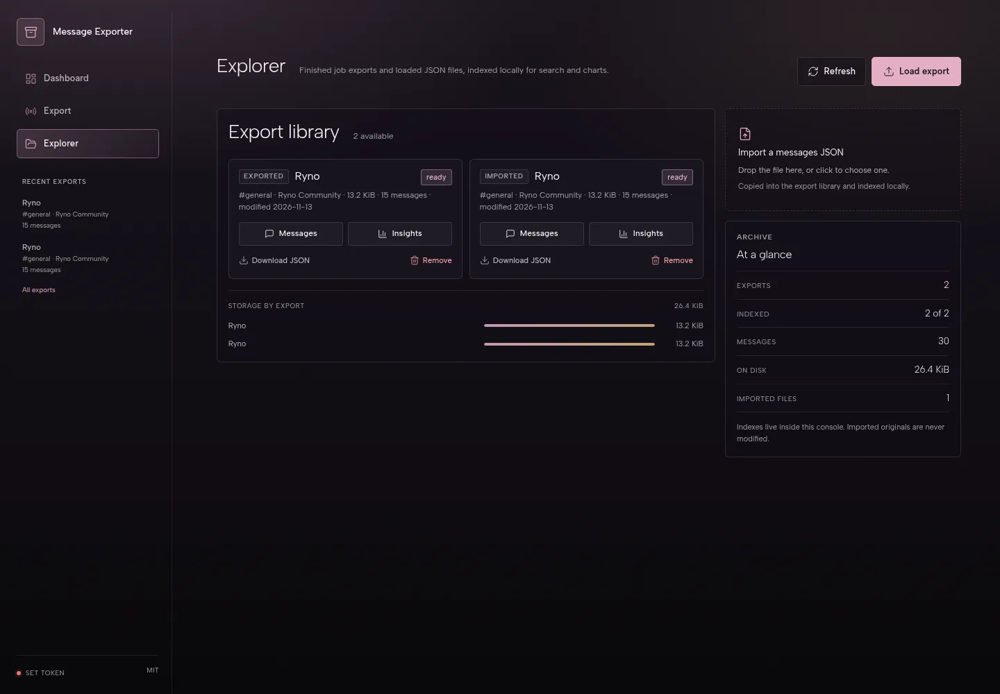
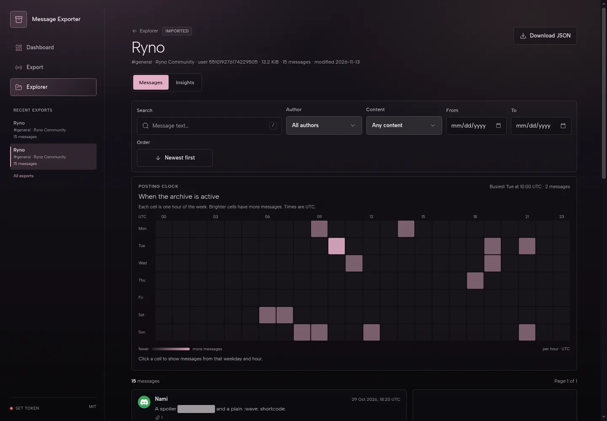
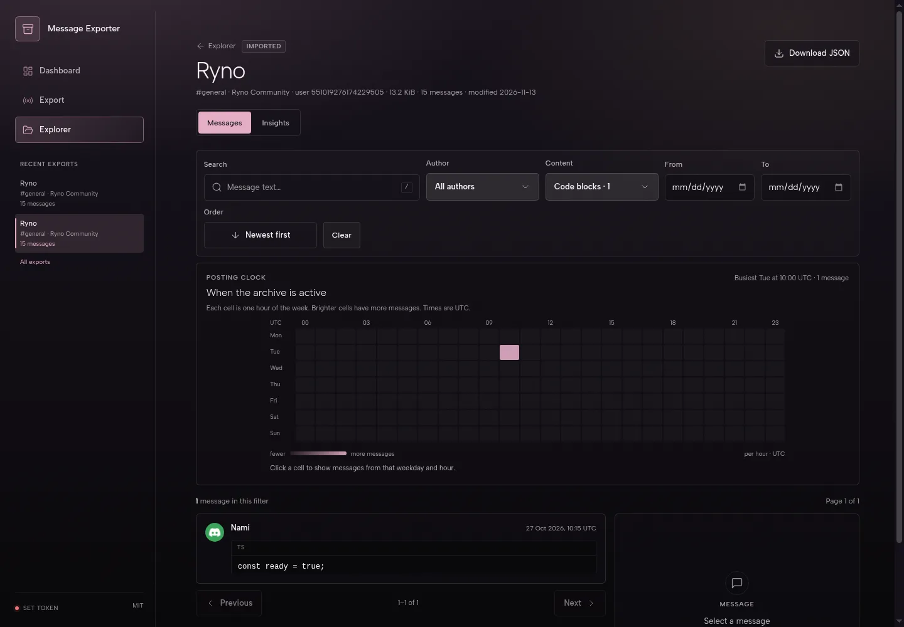
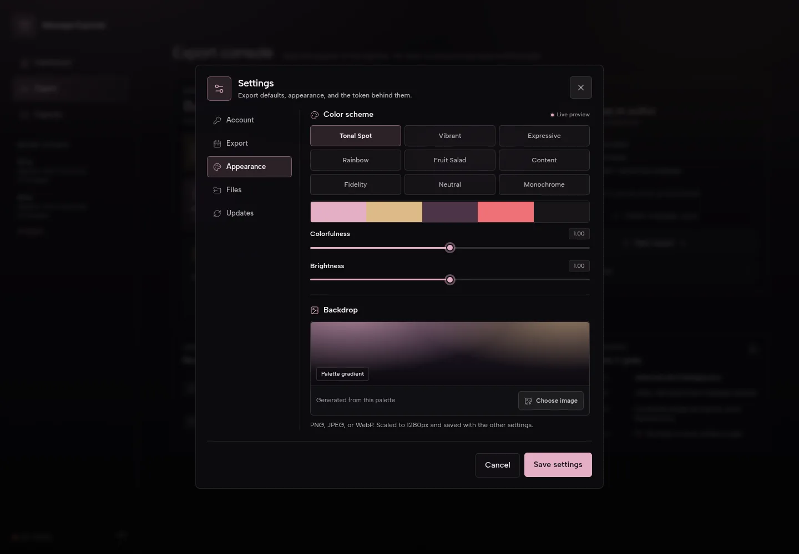

# Discord Messages Exporter

**Keep the conversations worth keeping.**

Export messages from Discord — one person, one channel, or an entire server — into a clean JSON file. Then open the local console to search, filter, and explore the archive without scrolling back through Discord.

[**Download the latest release →**](https://github.com/Rynowastaken/discord-messages-exporter/releases/latest)

Windows · Linux · Your archive stays on your machine



## ✨ What you get

- 🗂️ **Three ways to export** — one author, one channel, or every text channel in a server.
- 🔎 **A real search engine** — full-text search plus filters for author, channel, date, and content type.
- 🖼️ **Messages that look like messages** — markdown, custom emoji, reactions, replies, mentions, link previews, and attachments.
- 📊 **Insights worth opening** — activity over time, a weekday-by-hour posting clock, top authors, reactions, words, links, and more.
- 🎨 **A console you can make yours** — nine color schemes, brightness controls, and a custom background.
- 🔒 **Local by default** — your exports, index, and settings live on your computer.

## 🚀 Get started

1. **Download** the latest release for Windows or Linux.
2. **Open the app** and connect your Discord token when prompted.
3. **Pick a scope** — one author, a whole channel, or a server.
4. **Start the export**, then open it in the Explorer.

The Windows build is a portable folder: unzip it and run `Discord Messages Exporter.exe`. Linux builds are available as `.deb`, `.rpm`, and AppImage.

> The desktop app needs no separate Node.js install.

## 🧭 Take the tour

### Export

Choose a person, a channel, or a server. Set a date window, choose how attachments are handled, and watch the crawl progress live. Stop and resume whenever you need to — finished work is kept.



### Explorer

Every finished export and imported JSON file lives in one library. Load an older export, open its messages or insights, or download the original JSON again.



### Messages

Search the whole archive and narrow it down by author, channel, date, or content type. Pick out images, videos, audio, files, code blocks, links, or stickers in one click. The posting clock works as a filter too — click a busy hour to see what was posted then.





### Insights

See when the archive is active, who posts the most, which reactions and words come up again and again, and how message lengths are distributed. Every chart has a readable table or tooltip behind it.

### Appearance

Match the console to your setup with nine color schemes, adjustable colorfulness and brightness, and a custom background image.



## 🌐 Prefer the browser?

The same console can be self-hosted and opened at `http://127.0.0.1:8788`. You will need Node.js 24 or newer.

```bash
npm ci
npm --prefix web ci
npm run web:start
```

## 🔐 Your data stays yours

- Your Discord token stays in the server process, or in the OS keychain on Linux / a Windows-account-encrypted file on Windows if you choose to remember it. It is never written to browser storage.
- Exports, indexes, and settings are stored locally on your machine.
- Attachment downloads are optional. When you skip them, the export keeps metadata and Discord's signed CDN links — which expire.
- You can point the export folder anywhere you like in **Settings → Files**.

> ⚠️ Automating a user account is considered self-botting under Discord's Terms of Service and can put the account at risk. Prefer a bot token where possible, and only export content you have permission to keep.

## ❓ Good to know

- **Large exports are fine.** Crawls are split into ranges, progress is saved, and interrupted exports resume where they stopped.
- **Nothing is overwritten.** The Explorer reads exports without modifying them.
- **Where do exports go?** Each run is written to the app data folder under `runs/<job>/messages.json`. Set an **Export folder** in **Settings → Files** to also get a copy in a named folder you choose.
- **Imported files work too.** Already have a messages JSON? Drop it into the Explorer and it gets indexed for search and charts.
- **Need to report a problem?** Download a diagnostic server log from **Settings → Files → Download logs**. Tokens are redacted.
- **The JSON is yours.** It is human-readable and works without this app.

## License

MIT
